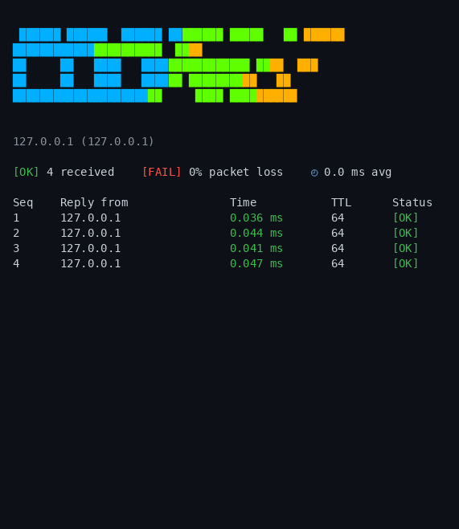

# 🛰️ CoolPing

CoolPing is a stylish, user-friendly alternative to the classic `ping` command. It provides emoji-based feedback, colorized output, continuous monitoring, and convenient logging, making network diagnostics more fun and informative.



## 📦 Core Features

- **Emoji Feedback:** Instantly see success ✅ or failure ❌ for each ping.
- **Color Output:** Colorful terminal output for easy reading (auto-disabled on non-TTY, with `--color never`, or when `NO_COLOR` is set).
- **Custom Packet Count:** Specify the number of pings with `--count N`.
- **RTT Color Coding:** Latencies are colored green (<50ms), yellow (<150ms), or red.
- **Continuous Monitoring:** Live dashboard with loss graph, RTT sparkline, jitter, quality rating, and uptime.
- **Logging:** Optional logging to `~/coolping.log` with `--log` (works in both modes).
- **No-Emoji Mode:** Compatible with legacy terminals using `--no-emoji`.

## 🚀 Installation

### Debian/Ubuntu

```bash
# coolping.deb always points to the latest release
sudo dpkg -i coolping.deb
```

#### Or install directly from GitHub (no git required)

```bash
wget https://github.com/edrisranjbar/coolping/raw/main/coolping.deb -O coolping.deb
sudo dpkg -i coolping.deb
```

### Manual Install

Copy the contents of `usr/` to the same paths on your system (`usr/local/bin/coolping` and `usr/local/lib/coolping/`).

## 🛠️ Usage

```bash
coolping [OPTIONS] <host>
coolping --help
```

### Options

- `--count N`        Number of packets to send (default: 4)
- `-c`, `--continuous` Run indefinitely with a live updating dashboard
- `--log`            Enable logging to ~/coolping.log
- `--no-emoji`       Disable emoji feedback
- `--color WHEN`     never, always, or auto (default)
- `-v`, `--verbose`  Show verbose output
- `-h`, `--help`     Show help message

Options also accept `=` syntax, e.g. `--count=10 --color=never`.

### Examples

#### Basic Usage
```bash
# Standard ping (4 packets)
coolping google.com

# Custom packet count
coolping --count 10 google.com

# With logging
coolping --log google.com
```

#### Continuous Monitoring
```bash
# Monitor with live stats dashboard
coolping --continuous google.com

# Monitor with logging enabled
coolping --continuous --log 8.8.8.8
```

The continuous dashboard shows total/success/fail counts, packet loss with a visual bar, a sparkline of recent latencies, latency stats (current, average, recent, jitter, min, max), a connection quality rating (★), and uptime.

## 📖 Manual Page

After installation, you can view the full manual with:

```bash
man coolping
```

This provides detailed usage, options, and examples for CoolPing.

## 📄 Logging

Enable logging with the `--log` flag. Single-shot runs log their summary to `~/coolping.log`; continuous mode logs state changes plus a heartbeat every 30 pings. You can review your ping history at any time.

## 🤝 Contributing

Contributions are welcome! Please open issues or pull requests on GitHub.

## 📜 License

This project is licensed under the MIT License. See [LICENSE](LICENSE) for details.

## 🔨 Building the .deb (from the repo root)

```bash
dpkg-deb --build . coolping_<version>_all.deb
cp coolping_<version>_all.deb coolping.deb   # stable name, always latest
```
